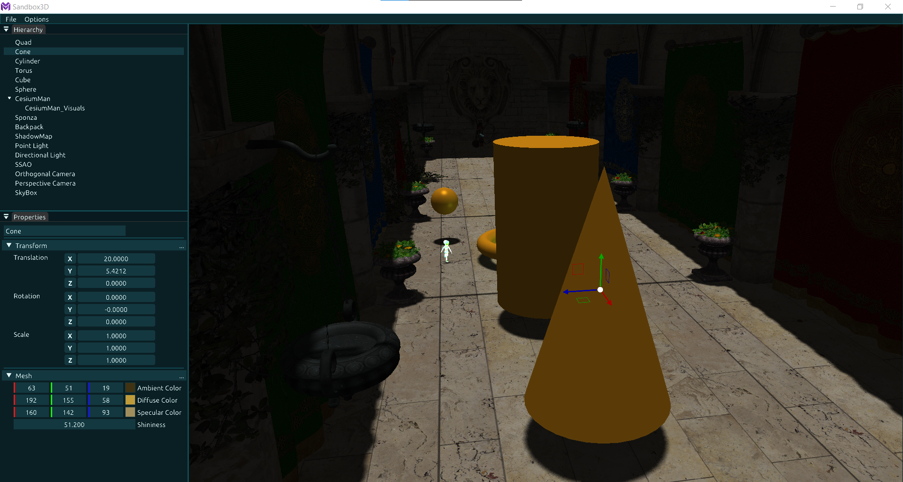

<div align="center">
  
  <h1>Monsi Engine</h1>
  <p>A lightweight, modular, and high-performance engine built in C++ for game and graphics development.</p>
</div>



## Features In Development

- Play Button
- Jolt Physics
- Indirect instancing
- Bindless rendering

## Features

- High-performance rendering using modern C++ and GLSL.
- Modular architecture for easy extension and customization.
- Sandbox environment for testing and prototyping.

## Getting Started

### Prerequisites

- C++20 compatible compiler (GCC, Clang, MSVC)
- CMake 4.4
- OpenGL 4.6

### Build Instructions

```bash
git clone
cd Monsi-Engine
mkdir build && cd build
cmake ..
cmake --build . --config <Debug/Release>
```

> **Visual Studio Users:** Go to **Tools → Options → CMake** and set the **CMake Executable directory** to `C:\Program Files\CMake\bin` (ensure CMake 4.4 is installed).
